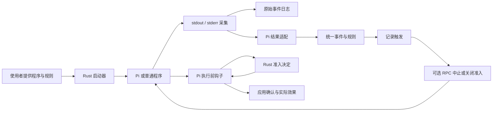

# inhibitor-lab：从项目意图到源码、证据与下一步

这是一份面向新协作者和 Agent 的单文件导读。先读完它，就应能说明项目为什么这样做、哪些行为已经证明、代码从哪里读，以及下一步应遵守哪些边界。需要追查具体实验时，再打开文内链接。

**事实快照：2026-10-05，阶段 10 完成只读恢复状态 R5；本阶段起点 `c93f324`。** `inspect`、`recovery prepare/confirm/start/status` 已实现；真实 Pi A 关闭后，经确认启动 B，修正输入组完成、未修正组再次关闭；R5 验证运行中未知与最终状态，修复缺少 RPC 过程证据却可能被诊断为完成的问题。72 项 Rust / 14 项 Node 通过。模型回复仍由本地固定服务提供，没有真实模型验证。历史报告中的“尚未实现”只描述该报告当时的阶段；全部阶段的成果、证据和责任见 [项目总报告](docs/project-report.md)。

文中相对路径都以独立仓库 `inhibitor-lab` 为根。本机位置是 `E:\MyProject\Rust\inhibitor\inhibitor-lab`，远端是私有仓库 `cn7shi/inhibitor-lab`；父目录是旧项目。接手时先核对 Git 根目录，避免把新工程改动提交到旧仓库。

前置基础：了解进程的 stdin/stdout/stderr、逐行 JSON、工具调用、同步与异步事件即可开始。读 Rust 时需要基本的 `Result`、`Option`、线程和通道概念；不要求先读完旧 Inhibitor 项目。

## 1. 先用五分钟理解这个项目

用户希望治理本地 Agent 反复出错的执行过程：能看到发生了什么、按明确规则触发控制、说明控制是否真的生效，并最终让人决定如何继续。旧方向要求使用者进入指定页面，用户认为这增加了接入负担，因此新实验选择从启动进程和读取输出切入。

长期设想包括管道启动器、本地日志读取和 MCP 观测。现在只实现了管道和 Pi 接入；本地日志文件跟随与 MCP 尚未实现。`inhibitor-lab` 是独立 Rust 工程，借鉴旧项目的治理意图，不是在旧项目上补功能，也不要求完整复刻。

当前最小问题是：**取得可靠信息 → 用显式规则触发 → 执行可核验控制**。先不做智能判错，也不要求模型理解错误根因。只有这条基础链路可靠，后续的诊断、优化和恢复才有依据。

例如，规则可以定义“本次运行累计两个工具报告失败”。这不等于两次连续失败，不等于相同根因，也不等于模型任务做错。`stderr` 和结果正文中的 `ERROR` 本身都不代表工具失败。

| 当前状态 | 内容 | 依据 |
| --- | --- | --- |
| 已实现并验证 | 文本采集、显式规则、Pi 结果适配、去重和证据关联 | [采集测试](tests/capture.rs)、[规则与适配](src/lib.rs) |
| 已实现并验证 | Pi RPC 合作式中止、响应关联、空闲确认、退出与期限处理 | [RPC 报告](docs/verification/pi-rpc.md) |
| 已实现并验证 | 执行前等待准入、关闭后拒绝新请求、默认拒绝和重放检查 | [准入报告](docs/verification/pi-gate.md) |
| 已验证的限制 | 同批已批准调用不能撤销；两层标准嵌套的新请求可以被拒绝 | [边界报告](docs/verification/pi-boundaries.md) |
| 已实现并验证 | 只读 `inspect` 检查证据链，说明触发、确认拒绝及后续继续条件 | [诊断报告](docs/verification/inspect.md)、[诊断测试](tests/inspect.rs) |
| 已实现并验证 | 新任务配置、明确确认、唯一待启动关联与摘要复核 | [R2 报告](docs/verification/recovery-prepare.md)、[确认测试](tests/recovery.rs) |
| 已实现并验证 | 单次启动关联子运行、重建计数与门禁、失败留档、关联诊断；模拟 Agent 进程回归 | [R3 报告](docs/verification/recovery-start.md)、决策 D015 |
| 已实现并验证 | 真实 Pi 两轮恢复，修正 / 未修正输入对照，实际文件效果、配置变化拒绝与重复启动拒绝 | [R4 报告](docs/verification/pi-recovery.md)、决策 D016 |
| 已实现并验证 | 只读恢复状态汇总、来源变化与历史结论分开、缺失结果不推断成功、完整协议收尾校验 | [R5 报告](docs/verification/recovery-status.md)、决策 D017 |
| 尚未实现或验证 | 真实模型联调、智能判错、本地日志跟随、MCP、全进程树治理 | [README](README.md) 当前限制 |

这里的“真实 Pi 验证”使用真实 Pi CLI 和真实工具，但模型回复由本机固定测试服务生成。它证明接入和控制行为，不证明真实模型的判断能力。

## 2. 为什么按这个顺序演进

这条路线先建立可观察事实，再增加控制。每一步都保留前一步的对照，避免只看到“规则触发了”就宣称“工具停止了”。

| 阶段与提交 | 当时要回答的问题 | 新增机制或修复 | 留下的取舍与证据 |
| --- | --- | --- | --- |
| 0 · `cd582be` | 能否启动程序并按规则记录输出？ | Rust 启动器、双流采集、文本阈值、JSONL | 只记录，不停止；[开发记录](docs/development-log.md) |
| 1 · `daa41fc` | 能否读懂真实 Agent 的工具结果？ | Pi JSON 适配与调用 ID 去重 | 选 Pi 作为第一个适配对象；规则保持独立；[本地接入报告](docs/verification/pi-local.md) |
| 1.1 · `391321f` | 损坏证据是否会被误当成有效输入？ | 拒绝损坏 UTF-8；修复半条日志影响清理的问题 | 先复现失败，再修复；[自查报告](docs/verification/self-review.md) |
| 1.2 · `e89064b` | 没有 OCR 模型 API 是否仍能审查？ | 使用委托规则；修复实验输出流错误处理 | OCR 提供范围和规则，宿主助手做判断；[委托报告](docs/verification/ocr-delegate.md) |
| 2 · `c8decbc` | 触发后能否请求 Pi 停下？ | 清队列、中止、查空闲、正常退出 | 中止有竞态，不能撤销动作；[RPC 报告](docs/verification/pi-rpc.md) |
| 3 · `ef64b8f` | 下一次工具执行前能否等待许可？ | Pi 扩展准入、Rust 决定、扩展应用确认 | 拒绝结果单独记录；只关闭新准入；[准入报告](docs/verification/pi-gate.md) |
| 4 · `858a143` | 并发和嵌套是否改变上述保证？ | 同批与两层嵌套四组对照、重放与迟到批准回归 | 没有修改生产控制逻辑；明确已批准调用的边界；[边界报告](docs/verification/pi-boundaries.md) |
| 5 · `786aa3e` | 别人能否接手，人工恢复应该恢复什么？ | 单文件导读和可评审设计 | 设计完成不等于命令已实现 |
| 6 · `9c99341` | 旧日志是否足以进入人工继续流程？ | 有界只读诊断、引用与终态校验 | 修复阈值上界和提前关闭误判；诊断不等于许可；[诊断报告](docs/verification/inspect.md) |
| 7 · `e68ea4c` | 人究竟确认了什么，能否重复确认旧计划？ | 明确新配置、内容摘要、唯一确认和预留子身份 | 修复单改副本路径复用 ID；确认不等于启动；[R2 报告](docs/verification/recovery-prepare.md) |
| 8 · `426514a` | 怎样单次消费确认并如实解释新进程结果？ | 原子启动占位、快照执行、实际父子关联、独立结果 | 并发只有一次启动；没有结果不代表没执行；[R3 报告](docs/verification/recovery-start.md) |
| 9 · `c93f324` | 恢复流程能否驱动真实 Pi，问题仍在时是否再关闭？ | 两组 A → 确认 → B、同样调用 ID、实际文件和摘要核对、CI 入口 | 修正由实验操作者执行；固定模型不代表真实模型；[R4 报告](docs/verification/pi-recovery.md) |
| 10 · 本阶段 | 怎样统一解释恢复记录而不误报成功或隐式重试？ | 只读八状态、严格关联、来源单列、前后比较；补强正常完成证据 | 不用 PID 推断存活，不将状态报告当许可；[R5 报告](docs/verification/recovery-status.md) |

几项关键选择贯穿这些阶段：

1. **先显式规则，后智能判断。** 用户主动缩小判错范围，先让信号和触发可重复；依据是 D001，而不是对模型能力的假设。
2. **Pi 只负责第一种接入。** 用户提出轻量、开源的 Pi 后采用它；Rust 中的规则依赖统一事件，Pi 协议留在适配和控制层。D002 记录选择过程。
3. **先固定回复，再接真实模型。** 用户选择模型稍后配置。测试服务让工具序列稳定，真实 CLI、文件操作、错误和管道仍然参与实验。D003 记录边界。
4. **中止与准入分开。** RPC 中止发生在收到失败之后；准入让工具在执行前等待。两者解决的时间点不同，不能用中止试验替代执行前验证。见 D008、D010。
5. **协议确认与效果分开。** 请求已写入、Pi 已响应、扩展已应用、文件是否存在、进程如何退出，是不同事实。控制结果必须结合这些证据解释。
6. **不靠钩子内等待强行串行化。** Pi 默认会先准备本批全部工具，再执行它们；让第二个钩子等待第一个工具结束可能阻塞整批。D011 因此保留新准入契约，调度策略另行设计。

完整备选、来源和适用范围在 [decisions.md](docs/decisions.md)。它保存决策；本文负责把决策串成可理解的路线。

## 3. 从一次运行看懂架构



这是机制示意，箭头不全是函数调用。进程输出、线程通道、RPC 命令及扩展事件都是异步边界；下一节给出实际阅读路线。

职责可以按三个问题区分：

| 问题 | 实现位置 | 责任 |
| --- | --- | --- |
| 发生了什么？ | [src/main.rs](src/main.rs)、[src/pi.rs](src/pi.rs) | 启动、采集、原始日志、转换工具结果、暴露不完整输入 |
| 是否达到显式条件？ | [src/lib.rs](src/lib.rs) | 验证规则、按来源与事件匹配、累计、每条规则只触发一次 |
| 应如何控制并证明结果？ | [src/control.rs](src/control.rs)、[src/gate.rs](src/gate.rs)、[tool-gate.js](integrations/pi/tool-gate.js) | RPC 生命周期、准入决定与应用确认、关闭条件、退出证据 |

### 例子：第二次读取失败后拒绝写入

1. 使用者以 `pi-rpc`、`--tool-gate`、`--on-trigger block` 启动。Rust 先通过 `get_commands` 查询扩展标记，确认存在后才发送业务提示。
2. Pi 的第一次 `read` 到达执行前钩子。扩展使用自有确认协议等待；Rust 写入 `gate_decision` 并回复放行。扩展通知实际采用结果，Rust 写入 `gate_applied`。
3. 工具读取不存在的文件，Pi 报 `tool_execution_end` 且 `isError: true`。Rust 先保留原文，再转为统一 `tool_completed`，规则累计一次。
4. 第二次读取重复上述路径。统一事件使计数达到 2，`record_triggers` 先保存触发和依据，随后 `RpcControl::trigger` 关闭准入。
5. 下一个新写入请求到达时，Rust 给出拒绝，扩展返回阻止结果。Pi 生成的合成错误进入 `tool_blocked_result`，不会再次当作真实工具失败累计。
6. Pi 完成本轮，Rust 收到 `agent_settled`，确认准入决定已应用，再关闭输入并等待进程退出。若完整性和退出都正常，最终结果为 `blocked`，启动器返回 3。

如果写入与两个读取在同一批里提前获准，第 5 步的前提就不存在：写入已有许可，关闭不能撤销它。这是已实测边界，不是测试偶发失败。

## 4. 按问题阅读源码：十一课大纲

本节提供稳定课程编号与经过核对的调用路线，状态均为**大纲**，不是逐行展开。需要进一步学习时，可以明确要求展开某一课；不会把所有文件混成一条不可能同时发生的调用链。

### C01 · 一条输出如何成为可信的原始记录

读完能回答：进程怎样启动、两个流如何进入日志、截断与损坏字节怎样处理？

主链：`run 命令 → parse_options → run → capture / read_line_bounded → Capture 通道 → Journal::emit → 输出或异常记录`。

1. [src/main.rs](src/main.rs) 的 `main` / `parse_options`：输入命令行，验证格式及模式约束，输出 `Options`；下一步交给 `run`。
2. 同文件 `run`：加载规则，以 `create_new` 创建日志，通过 `Command` 参数直接启动子进程；输入是配置，输出是进程及管道，不经过额外 shell。
3. `capture` → [src/lib.rs](src/lib.rs) 的 `read_line_bounded`：每行最多保留 64 KiB，超出部分读完丢弃；输出文本、截断与编码损坏标记，送入容量 256 的通道。
4. 回到 `run` 的接收循环：先 `Journal::emit("output", ...)`，再转发和判断是否允许进入后续规则；序号由单个日志写入点生成。

选读证据：[tests/capture.rs](tests/capture.rs)。暂缓：Pi 去重由 C02 负责，RPC 期限由 C03 负责。复述任务：说明“采集到了文字”和“得到了可计数证据”为什么不是同一件事。

### C02 · 两次工具失败为什么只触发一次

读完能回答：失败从哪里来、重复记录如何处理、阈值何时重置？

主链：`有效 Pi stdout → PiAdapter::observe → AgentEvent → RuleEngine::observe_event → RuleState::record_match → record_triggers`。

1. [src/pi.rs](src/pi.rs) 的 `PiAdapter::observe`：输入一条 JSON，只规范化带非空调用 ID / 工具名及布尔 `isError` 的工具结束事件；同一调用的相同结果忽略，冲突结果报错。
2. [src/lib.rs](src/lib.rs) 的 `AgentEvent` / `EventFilter::accepts`：统一结果携带调用 ID、工具名和失败标记；可按工具名过滤，不分析错误正文。
3. `RuleEngine::observe_event` → `RuleState::record_match`：规则在本次运行累计，达到阈值设为已触发；成功不会重置计数，触发后的规则不再重复触发。
4. [src/main.rs](src/main.rs) 的 `record_triggers`：写下触发序号和依据，再把控制意图交给 `RpcControl::trigger`。文本规则另走 `RuleEngine::observe`。

选读证据：规则单元测试、[examples/pi-rules.json](examples/pi-rules.json)、采集进程测试。暂缓：控制动作由 C03 / C04 负责。复述任务：解释成功结果正文含 `ERROR` 为什么不增加失败次数。

### C03 · 请求中止之后，如何知道运行真的结束

读完能回答：为什么不能只看 `abort` 的成功响应？

主链：`显式 abort 模式 → 首次触发 → clear_queue → abort → get_state → 空闲确认 → 关闭 stdin → 进程退出与最终结果`。

1. [src/control.rs](src/control.rs) 的 `RpcControl::new` / `send`：独立线程写 stdin，主循环不被子进程拒绝读取输入卡住；命令进入有界队列，写入事实单独记录。
2. `trigger`：首次中止设置控制期限；多个规则可以分别记录，但只开始一条中止流程。
3. `observe`：依次验证响应 ID、命令名、成功标记，再查流式状态、压缩状态和待处理消息数；仅在空闲且队列为空时确认协议中止。
4. [src/main.rs](src/main.rs) 的 `run`：持续检查 `expired`，处理输入关闭、输出结束、进程退出；协议确认后崩溃仍报告失败。自然完成等待 `agent_settled`，不是仅看 `agent_end`。

选读证据：[tests/control.rs](tests/control.rs)、[RPC 报告](docs/verification/pi-rpc.md)。暂缓：执行前准入由 C04 负责。复述任务：说明协议确认、进程退出、采集完整三者各证明什么。

### C04 · 工具怎样在执行前等待批准

读完能回答：门禁放在哪里，决定和实际采用如何关联？

主链：`查询扩展标记 → 发送提示 → tool_call 钩子 → 自有确认请求 → ToolGate::observe → 准入回复 → 扩展通知 → gate_applied`。

1. [src/control.rs](src/control.rs) 的 `prompt` / `observe`：启用门禁时先 `get_commands`，核对协议标记后发送提示；缺失扩展时停止。
2. [integrations/pi/tool-gate.js](integrations/pi/tool-gate.js) 的 `toolGate`：注册 `tool_call`，只在 RPC 环境等待明确布尔批准；超时、取消、异常与拒绝会锁住本轮拒绝状态。
3. [src/gate.rs](src/gate.rs) 的 `ToolGate::observe`：验证请求 ID / 工具调用 ID / 名称，拒绝重复请求，记录决定；只有本项目协议获得自动回应。
4. `ToolGate::close` 使新请求被拒绝；扩展通知经 `observe` 对应到决定。`blocked_result` 核对结束结果，并使合成拒绝错误绕过普通失败计数。
5. `complete` 与 RPC 收尾共同检查已发决定是否被应用；`run_finished` 综合控制结果、采集与退出，不能拿“决定已发送”替代“已应用”。

选读证据：[tool-gate.test.mjs](integrations/pi/tool-gate.test.mjs)、控制进程测试、[准入报告](docs/verification/pi-gate.md)。暂缓：并发与嵌套差异由 C05 负责。复述任务：说明 `gate_closed` 和 `blocked` 为什么不能合并成一个结果。

### C05 · 为什么第三个同批工具仍可能执行

读完能回答：已有许可、新许可和嵌套父工具的关系是什么？

主链：`同批回复 → Pi 准备全部调用并申请准入 → 执行 → 失败触发关闭 → 下一批新申请被拒绝`；嵌套变体通过 `ctx.executeTool()` 再次进入同一钩子。

1. [check-boundaries.mjs](integrations/pi/check-boundaries.mjs) 的 `batches` / `runCase`：产生固定同批输入，断言前三次批准都早于首个工具结果，核对各个效果文件。
2. 同文件的 `decisions` / `parentLinks` 检查：每次决定必须有应用确认；触发之后不得出现新放行；父子关联从原始 Pi 事件追到准入序号。
3. [boundary-tools.js](integrations/pi/boundary-tools.js) 的 `boundaryTools`：仅在测试中加载，组织两层调用，首次拒绝后仍故意再申请一次；文件操作走内置工具。
4. 外部实现边界：锁定依赖的 `pi-agent-core/dist/agent-loop.js` 中 `executeToolCallsParallel` 先准备再执行；Pi 的 `nested-tool-calls.js` 负责标准嵌套事件。它们不属于本仓库维护的源码。

选读证据：[边界报告](docs/verification/pi-boundaries.md)、`replaying_an_old_tool_or_request_after_closure_cannot_reuse_approval` 回归。暂缓：嵌套内部并行、任意深度和严格调度均未实现专项验证。复述任务：区分“准入已关”“原父工具还在运行”“新子调用被拒绝”。

### C06 · 测试、失败记录和清理怎样让结论可信

读完能回答：本地固定模型测试证明什么，遇到失败如何保留真实结论？

主链：`测试服务固定回复 → 真实 Pi / 工具 / Rust → 同时捕获输出与退出 → 断言证据及效果 → 保存摘要；失败则清理并保留错误`。

1. [check-local.mjs](integrations/pi/check-local.mjs)：构造独立工作区和模型配置，运行 JSON、RPC、单调用准入对照；仅中止对照使用相同一秒回复窗口，不能推广为零竞态保证。
2. [capture-output.mjs](integrations/pi/capture-output.mjs) 的 `captureOutput`：立即观察文件流和子进程错误，成功须等输出完成；失败 / 超时统一调用清理，清理失败保留双重错误。
3. [process-cleanup.mjs](integrations/pi/process-cleanup.mjs) 的 `readStartedPid` / `stopRun`：有界读取第一条完整启动记录，避免半条尾记录妨碍本地实验清理；不是全进程树治理。
4. [.github/workflows/check.yml](.github/workflows/check.yml)：干净 Windows 环境执行 Rust、Node 与真实 Pi 对照。版本、范围和最终结果随提交关联。

选读证据：两个 Node 测试文件、[自查](docs/verification/self-review.md)和[委托复核](docs/verification/ocr-delegate.md)。暂缓：磁盘耗尽、系统崩溃、长期负载与真实模型。复述任务：说明“本地链路通过”为什么不等于“模型不会犯错”。

### C07 · 怎样读旧日志而不误把摘要当成许可

读完能回答：为什么日志末行写着 blocked 不足以继续，为什么有效诊断也可能不满足继续条件？

主链：`main 的 inspect 分支 → inspect::command → inspect → load → validate → Report → 中文 / JSON 输出`。

1. [src/main.rs](src/main.rs) 的 `main`：分派只读命令，与创建子进程的 `run` 分开；没有恢复或解锁入口。
2. [src/inspect.rs](src/inspect.rs) 的 `command` / `load`：通过 [evidence_file::read](src/evidence_file.rs) 有界读取，检查完整换行、版本、运行 ID 与连续序号；输出事件列表和同一份字节的摘要，不执行其中的程序字段。
3. `validate` / `earlier` / `raw`：引用只能指向更早记录，工具结果要与原文对应；按引用位置统计证据上界，串起关闭、决定、确认和收尾。状态来自整条链，不能由末行单独决定；提前输入关闭不能充当正常收尾。
4. `Report`：区分诊断有效性与 `eligible_for_manual_restart`，保留拒绝原因、触发依据和确认拒绝数量；`valid` 对应退出 0，但后续继续条件可能仍为 false。损坏 / 不完整返回 2，不保留可继续结论。

选读证据：[tests/inspect.rs](tests/inspect.rs)、[诊断报告](docs/verification/inspect.md)、`check-boundaries.mjs` 的诊断与日志不变断言。R2 确认见 C08，R3 启动见 C09，R4 双轮验证见 C10。复述任务：解释两次工具结果为什么不能支持阈值 999，以及为什么内部一致的日志仍不等于人工授权。

### C08 · 怎样把一次确认绑定到具体任务与证据

读完能回答：人确认了哪些内容，查看期间变更怎样处理，为什么两个确认进程只有一个成功？

主链：`recovery prepare → inputs / recovery_snapshot → identity → create(计划)`；随后 `recovery confirm → verify → 完整展示与精确输入 → 重新 verify → create(唯一确认)`。

1. [src/recovery.rs](src/recovery.rs) 的 `NewRun` / `inputs`：输入用户本次提供的原因、提示、规则、目录、程序参数及期限；拒绝未知字段 / 空规则，解析路径，输出新配置和内容摘要。模式固定为 Pi RPC 门禁 block，不从旧日志复制可执行命令。
2. [src/inspect.rs](src/inspect.rs) 的 `recovery_snapshot`：复用 R1 验证，父日志诊断与 SHA-256 必须来自同次读取，输出父身份、触发 / 关闭证据和终态。`identity` 绑定计划位置、准备时间及输入快照；修改副本位置后不能沿用原 ID。
3. `confirm` / `verify`：先核对来源再展示完整计划，只有 `CONFIRM <id>` 加换行才进入再次检查。错误文本 / EOF 取消；等待期间计划、父日志、配置或规则变化均拒绝。此时 `planned_run_id` 仅是预留身份，没有实际子运行。
4. [src/evidence_file.rs](src/evidence_file.rs) 的 `create`：用 `create_new` 仲裁并发唯一性，再写入和同步。`try_exists` 只为早报错，不能替代原子创建；半文件保留，重复确认不覆盖。确认结果 `confirmed_not_started` 保存确认时的事实，后续是否消费由启动记录说明。

选读证据：[tests/recovery.rs](tests/recovery.rs) 的双进程确认和等待时变更回归、[check-recovery.mjs](integrations/pi/check-recovery.mjs) 的独立摘要核对及 [R2 报告](docs/verification/recovery-prepare.md)。启动消费见 C09。复述任务：说明为什么“确认只保存一次”不能直接推导“进程只启动一次”。

### C09 · 怎样把一次确认变成可追溯的新运行

读完能回答：为什么确认和启动要各占用一次文件，为什么子运行还会关闭，以及没有结果时为什么不能直接重试？

主链：`recovery start → verify / Confirmation → create(启动占位) → 再次复核 → execute(内存规则快照、RunContext) → run_started / run_linked → 独立结果`。

1. [src/recovery.rs](src/recovery.rs) 的 `start`：严格解析确认，核对身份、计划原位置和摘要，创建 `.start.json`。两进程同时通过前置检查也只有一个能唯一创建占位；部分文件也占用该计划。之后的失败不撤销占位。
2. [src/main.rs](src/main.rs) 的 `execute` / `RunContext`：普通 `run` 和恢复启动共用执行循环；恢复从已验证的规则快照建立新引擎，使用确认的工作目录和预留 ID，重新创建适配器与门禁。执行阶段不重新读取可能变化的规则文件。
3. `RunLink` / `validate_link` 与 [src/inspect.rs](src/inspect.rs) 的 `validate`：子日志第一条仍给出启动 PID，第二条关联父身份、父摘要、计划摘要与确认摘要。诊断要求位置、ID 和字段正确；父资格另由准备 / 启动流程核对，不递归执行外部日志内容。
4. `RunProgress` 与结果记录：区分未尝试创建、创建失败、启动后运行器异常及完整收尾。`run_finished` 还要结合返回码与控制结果；再次关闭返回 3，控制失败返回 2。`.result.json` 绑定启动记录摘要，确认原件不改。

选读证据：[恢复进程测试](tests/recovery.rs) 的双启动竞争、计数重置 / 再次关闭、错误输出管道及关联损坏测试；[R3 报告](docs/verification/recovery-start.md) 的持久化日志与独立摘要核对。真实 Pi 双轮见 C10；暂缓断电 / 磁盘耗尽注入、程序二进制与环境绑定。复述任务：画出“确认完成 → 启动占位 → 创建进程 → 写关联 → 写结果”五步，说明任一步中断后哪些事实能确认，哪些不能。

### C10 · 怎样用真实 Pi 和文件效果证明恢复流程

读完能回答：什么证明 B 是新任务，什么证明新计数生效，为什么不能把修正组成功称为自动修复？

主链：`check:recovery → runCase → Pi A 失败并关闭 → inspect → 准备输入条件 → checkRecovery → recovery start → Pi B → verifyRun / 文件快照 / 摘要 → 重复启动拒绝`。

1. [check-recovery-runs.mjs](integrations/pi/check-recovery-runs.mjs) 的 `runCase` / 本地服务：两组隔离，每组 A / B 使用相同规则、提示和工具调用 ID。服务只在运行时接受模型请求，并要求每个新进程首个请求含零条工具历史、一个明确用户提示；禁用会话保存和模型重试，不添加人为延迟。
2. 输入条件：A 两次读取报告真实 ENOENT，随后写入被拒绝，工作目录仍为空。repaired 由实验代码在 A 结束后补齐两个文件；unchanged 不动。它们既是测试条件，也是需要明确记录的外部动作，不是治理程序的修复功能。
3. `checkRecovery` / `execute`：复用 R2 准备、取消、确认和独立摘要检查。repaired 额外修改已确认配置，验证启动被拒绝且不产生启动 / 子日志，再在新位置重新准备确认。所有 `start` 尝试异步执行，避免阻塞同进程的模型服务；输出和异常清理使用既有 helper。
4. `verifyRun` / `workspaceSnapshot`：B 同样的工具 ID 再次被识别；未修正组仍先批准两次读取，第二次失败才触发，第三次写入拒绝。修正组无触发、三次准入成功，并校验实际 `effect.txt` 内容。分别检查父原文、关联记录、确认 / 占位 / 结果摘要和重复启动前后的完整文件字节。

选读证据：[R4 报告](docs/verification/pi-recovery.md)、两组 `summary.json` 与 CI 的 `check:recovery`。暂缓：真实模型联调、自动修复、系统崩溃和任意后代清理。复述任务：分别列出“模型回复固定”“工具是真实执行”“文件是实验修正”“恢复必须重新确认”四件事的证据，说明各自能证明什么。

### C11 · 怎样汇总恢复状态而不把未知当成功

读完能回答：为什么来源变化不一定推翻历史完成，为什么完整子日志也不能代替缺失的启动结果？

主链：`recovery status → diagnose / snapshot → evaluate → verify_plan / verified_confirmation → 占位与结果核对 → recovery_child / validate → 再次 snapshot → Report`。

1. [src/recovery/status.rs](src/recovery/status.rs) 的 `snapshot`：只从规范计划位置派生配套路径，有界读取五份记录，区分不存在、不可读和已有字节；不按记录内任意输出路径跳转。
2. `evaluate` → [src/recovery.rs](src/recovery.rs) 的 `verify_plan` / `verified_confirmation`：核对历史身份、计划位置及确认摘要。另用 `verify` 检查当前父日志 / 配置 / 规则；变化保存在 `source_check`，不会把已核对的历史终态改成没发生。
3. 核对启动占位、结果、实际子 ID / PID 和关联；[src/inspect.rs](src/inspect.rs) 的 `recovery_child` 验证调用者持有的同一份子日志字节。完整完成需要提示被接受、稳定状态、控制响应和输入关闭等过程；运行器异常仅能用启动前缀核对身份，不承诺最终影响已结束。
4. `diagnose` 再次读取比较：记录变化报告未知；缺失 / 半结果也保持未知。`Report` 固定只读且不签发许可；已知失败可返回 0，未知 / 无效 / 启动前来源变化返回 2，因此调用者必须读 `state`。

选读证据：[R5 报告](docs/verification/recovery-status.md)、[恢复测试](tests/recovery.rs)、真实 Pi 的 `live-status.json` / `final-status.json`。暂缓：原子文件快照、作者认证、进程存活探测、系统崩溃注入。复述任务：解释“没有启动记录”“有占位但没有结果”“历史完成但配置删除”三种情况各能证明什么。

## 5. 怎样读懂一份运行证据

每一行日志包含版本、运行 ID、递增序号、采集时间、事件类型及数据。跨流序号是 Rust 的采集顺序；时间戳不是工具内部的精确发生时间。

事件关联分为两条主要链：

- 触发原因：`rule_triggered.data.matched_event_sequence → agent_event → data.raw_event_sequence → output`。文本规则直接指向对应输出。
- 拦截效果：`gate_closed.data.trigger_sequence` 和拒绝决定的 `gate_decision.data.trigger_sequence` 回指 `rule_triggered`；`gate_applied.data.decision_sequence` 回指 `gate_decision`；`tool_blocked_result.data.raw_event_sequence` 回指合成结果原文。再结合最终完整性、退出和测试文件效果。

例如，已保存的批次拦截实验中，写入批准为序号 42，第二个失败原文为 48，触发为 50、关闭为 51，同批写入成功结果为 52。它证明先前批准没有被收回；不能据此推断文件系统调用精确发生在关闭之后。后续两个写入新请求被拒绝，两个文件不存在。详情在边界报告。

| 结果字段 | 应怎样理解 |
| --- | --- |
| `control_outcome: completed` | 协议运行完成，不是模型任务质量评分 |
| `aborted` | 中止协议和退出等检查满足；仍不能撤销已完成动作 |
| `gate_closed` | 门已关闭，但没有确认拒绝过后续调用 |
| `blocked` 与 `blocked_tool_count` | 有扩展应用拒绝的证据及数量；不表示所有活动进程都已停止 |
| `failed`、完整性为 false 或 `forced_cleanup: true` | 不可报告正常控制成功；检查异常记录 |
| `run_finished.exit_code` / `success` | 描述实际子进程，不是启动器退出码 |

启动器退出 3 表示正常收尾的受控停止；退出 2 表示自身采集、适配或控制失败。观察模式也可能原样返回子进程自己的 2 或 3，因此**不能跨模式只凭退出码分类**，要一起看日志。

`runs/` 被 Git 忽略。换一台机器通常没有旧原始日志；可以读取已提交报告及关联 CI，或运行同一脚本产生新的证据。不要把原始日志不存在说成实验未做，也不要在未复现时假装拥有原始证据。

## 6. 已经历的失败，以及它们改变了什么

| 真实问题 | 修正与后续约束 |
| --- | --- |
| 损坏 UTF-8 替换解码后成为合法 JSON，可能参与计数 | 保存编码损坏标记，Pi 损坏行不能成为规则证据；合法替代字符本身不能被误杀 |
| 超时时解析整份日志，半条尾记录阻止找到子进程 | 只读第一条完整启动记录；以后改日志格式必须注意这个依赖 |
| 输出文件流错误监听过晚，Node 未处理异常跳过清理 | 捕获开始就监听流和退出；失败后统一清理，同时保留原错误 |
| 误以为没有模型 API 就不能使用 OCR | 更正为使用 `delegate preview` / `delegate rule`；由宿主助手判断，不宣称独立模型复审 |
| Node 24.17.0 下中止确认后 Pi 退出崩溃 | 两次均记录整体失败；通过 Scoop 升至 24.20.0 后同样对照通过；没有把响应成功当作运行成功 |
| 准入前参数校验可能不经过钩子 | 缺少准入证据的结果当前保守按协议失败结束，不从错误文本猜测是否执行 |
| 正常完成曾只核对末行字段，缺少过程也可被接受 | R5 先复现失败，再要求完整 RPC 收尾；状态汇总复用同一份日志字节验证，不能靠完成摘要冒充过程 |

环境升级与症状的对应支持运行时缺陷判断，但没有独立调试 Node 原生崩溃栈。历史解释及上游来源见 D009，不能扩写成已证明全部底层根因。

## 7. 在新机器上复现现有能力

先阅读 [README](README.md) 的环境说明。已验证基线为 Windows、Rust 1.96.0、Node 24.20.0、Pi 1.0.3；依赖由锁文件固定。用户偏好 Scoop 管理开发工具，Pi 使用项目内 npm 依赖，MSVC / Windows SDK 是已告知的外部组件。不要为读文档重装环境。

在仓库根目录执行已存在的命令：

```powershell
npm ci --prefix integrations/pi --ignore-scripts --no-audit --no-fund --cache .npm-cache
cargo build --locked --bins
cargo fmt --check
cargo test --locked
cargo clippy --locked --all-targets -- -D warnings
npm --prefix integrations/pi test
npm --prefix integrations/pi run check:local
npm --prefix integrations/pi run check:rpc
npm --prefix integrations/pi run check:gate
npm --prefix integrations/pi run check:boundaries
npm --prefix integrations/pi run check:recovery
```

历史基线 `858a143`：31 项 Rust、14 项 Node 测试通过，所有真实 Pi 对照通过，[对应 CI](https://github.com/cn7shi/inhibitor-lab/actions/runs/37318689834) 成功。阶段 6 增至 43 项 Rust；阶段 7 增至 54 项；阶段 8 增至 62 项，其中恢复 19 项，[阶段 8 CI](https://github.com/cn7shi/inhibitor-lab/actions/runs/37329144214) 全部通过。阶段 9 不改 Rust，新增 `check:recovery` 的两组真实 Pi A / B 对照并纳入 CI，Node 14 项也通过。`check:boundaries` 中的 R2 仍只确认；真正启动 B 的 R4 位于独立脚本，详情见各阶段报告。

如果只想先看最小效果，构建后运行：

```powershell
.\target\debug\inhibitor-lab.exe run --rules examples/rules.json -- .\target\debug\mock-agent.exe repeat
```

它产生三行匹配输出、一次阈值触发，仍正常完成。然后按 JSON 观察、RPC 中止、准入、边界四个脚本逐步阅读证据。每个脚本会显示证据目录；实验脚本自己核对启动器预期的退出 3，所以脚本验收通过时仍返回 0。

阶段 10 新增 10 项状态回归，全项目 72 项 Rust / 14 项 Node 通过，真实 Pi 两轮恢复与四组边界复验通过；正常完成诊断要求完整 RPC 收尾，状态来源与历史结论分开。新增状态检查接入现有 Pi 实验，不增加模型请求。详情见 [R5 报告](docs/verification/recovery-status.md)。

## 8. 人工确认后开启关联的新运行

**状态：R1–R5 已完成，真实模型联调仍待用户配置。** 当前 `--help` 包含 `run`、`inspect`、`recovery prepare/confirm/start/status`。确认记录保留当时尚未启动的事实，独立启动占位和结果说明之后的行为；没有 `resume` 别名。

### 8.1 恢复的是继续工作的许可

旧运行 A 已经关闭准入并正常结束。使用者先查看原因和已有影响，说明下一步打算做什么，再明确确认创建运行 B。B 有新进程、新计数、新门禁和新日志；通过关联记录回指 A。

第一版不恢复旧 Pi 内存会话，不自动重放旧提示或被拒绝工具，不撤销文件变化，也不保证失败根因已消失。B 如果再次累计两个失败，应再次关闭，不能因为“恢复过”就绕开规则。

这个选择与现有单提示、正常结束后关闭 stdin 的实现一致。若要原会话暂停后恢复，必须另行设计等待时限、规则重新启用、扩展锁定重置和并发中在途请求；本轮不混入这个状态机。

### 8.2 使用者看到的流程

1. **查看原因**：指定 A 的日志，只读展示触发规则、阈值、证据、确认拒绝数、最终完整性和退出状态。已放行工具可能产生的效果标为需要核对，不能从一个开始事件推断实际文件变化。
2. **准备下一步**：明确选择新的提示、规则、工作目录、程序与参数，填写继续原因。当前旧日志只记录程序、PID、格式及事件，没有完整启动配置，不能自动拼成可执行重放命令。
3. **确认本次继续**：展示 A 的身份和结果、新运行将做什么、哪些计数会重置。未确认、取消或输入结束时不启动子进程。
4. **创建 B 并记录关联**：保留 A 原文不改；B 使用新日志，记录父运行和被确认的触发依据，正常经过扩展检查与准入流程。
5. **查看结果**：用 `recovery status --plan <plan>` 汇总 B 的状态；完成、再次被拦截、失败及未知分别解释。选择继续不等于继续已成功。

### 8.3 第一版准入条件与拒绝条件

第一版只从已结束的 `pi-rpc` 门禁运行继续：A 有关联正确的规则触发与 `gate_closed`，最后一条是同一运行的 `run_finished`，结果为 `blocked` 或 `gate_closed`，子进程退出正常、采集与适配完整、没有强制清理。

解析必须检查版本、唯一运行 ID、序号和事件引用；不能只搜索日志中有没有 `blocked` 字样。损坏 JSON、半条尾记录、引用缺失、仍未结束、控制失败、未知版本一律显示原因并禁止进入普通恢复路径。前期的 `record` / `abort` 模式暂不作为此恢复入口。

日志是诊断数据，不是可执行指令。恢复参数来自本次明确输入；默认继续使用 `pi-rpc + tool-gate + block`。开启新运行只是重置本地计数，不能声称旧运行的任意后代进程已经被终止。

### 8.4 已实现诊断与恢复接口

下表标明当前可执行的入口：

| 入口与状态 | 输入 | 行为 |
| --- | --- | --- |
| 已实现 `inspect --log <path> [--format text\|json]` | 旧日志路径 | 只读解释触发与终态，给出是否满足继续条件及理由；不启动程序 |
| 已实现 `recovery prepare --parent <log> --config <json> --out <plan>` | 合格父日志、本次明确填写的配置、未占用输出位置 | 保存含父证据、摘要、预留子身份的新计划，不启动程序 |
| 已实现 `recovery confirm --plan <plan>` | 原位置计划、查看后输入的精确确认文本 | 前后复核，唯一创建 `.confirmed.json`，状态为尚未启动 |
| 已实现 `recovery start --plan <plan>` | 已确认计划及再次核对的来源 | 原子占用 `.start.json`，启动子运行、写入 `.run.jsonl` 与独立 `.result.json` |
| 已实现 `recovery status --plan <plan> [--format text\|json]` | 原位置计划及配套记录 | 只读核对八种状态，来源检查单列；不启动、不重新确认、不推断 PID 存活 |

诊断返回 0 只代表有效报告，必须另看继续条件；无效 / 未结束返回 2。输入上限为 32 MiB、单行 1 MiB、100,000 条事件。日志作者没有被认证，旧规则条件也无法完整重算；较早日志缺少关键字段时明确拒绝，不自动迁移。`inspect` 没有签发许可；启动必须持有与计划一致的确认记录并重新核对来源。

R2 计划和确认现已保存：父 `run_id`、父日志内容摘要、触发与关闭序号、`recovery_id`、预留新运行 ID、继续原因、确认时间、计划 / 新配置 / 规则摘要与快照。摘要用于发现内容变化，不是抵御同权限修改者的认证。环境变量不写入记录；提示和参数会持久化，不应放模型密钥。不盲目复制旧模型输出作为新指令。

确认前后复核父日志和本次配置；取消 / EOF 返回 3，变更或重复返回 2，同一计划原位置只有一份确认能成功保存，已有文件不覆盖。R3 启动前再次复核，原子占位后再检查来源，执行冻结在内存中的配置和规则快照；这仍不是锁定整个文件系统。**确认与启动的双进程竞争均已验证，不能推导为系统崩溃下的事务保证。** 完整操作见 [README](README.md)、[R2 报告](docs/verification/recovery-prepare.md) 与 [R3 报告](docs/verification/recovery-start.md)。

启动前的恢复记录与新运行日志分开保存，保留现有“首条 `run_started` 提供 PID”的实验清理契约。新子进程启动后，第二条为 `run_linked`。父日志不追加或改写历史。`.result.json` 的 `run_finished` 只说明完整收尾，必须结合 `launcher_exit_code` 与 `finish.control_outcome`；其它状态为 `not_spawned`、`spawn_failed`、`runner_failed`。

崩溃可能发生在操作系统启动进程和写入关联之间，这不是文件记录能自动解决的原子事务。遇到这种不确定状态应标明“启动结果未知”，禁止自动重复启动，待人工核对；不承诺恰好一次执行。启动失败也须保留恢复记录，重试重新确认。

### 8.5 实现顺序与验收

| 顺序 | 具体交付 | 通过条件 |
| --- | --- | --- |
| R1 · 已完成 | 只读日志读取与 `inspect` | 12 项诊断测试与真实 Pi 四组通过；有效门禁日志说明准确；截断、伪终态、跨运行引用、未知版本被拒绝；原文不变、无执行副作用 |
| R2 · 已完成 | 新运行配置、唯一确认与待启动关联 | 11 项确认测试及两份真实 Pi 父日志验证通过；取消不确认、变化失效、并发唯一、原文不变 |
| R3 · 已完成 | 共用执行器，重新建立规则与门禁，实际关联和结果 | 新增 8 项进程回归；B 从零计数且再次触发；启动 / 控制 / 转发失败如实保存，竞争和冲突不重复创建或覆盖 |
| R4 · 已完成 | 真实 Pi 两轮对照与拒绝回归 | 两组共四次真实 Pi 运行；A 两次失败关闭；修正输入后 B 完成并写文件，未修正则再次关闭且文件不存在；变化后的旧确认和重复启动拒绝，摘要链 / 原文核对通过 |
| R5 · 已完成 | 只读状态、完整证据链及总报告 | 新增 10 项恢复测试；真实 Pi 待确认 / 待启动 / 运行中未知 / 完成 / 再次关闭及来源失效；查看不修改证据或增加模型请求 |

实际运行时的人类身份认证不在第一版范围。测试模拟确认只验证程序契约，不宣称已经做过真人使用研究。跨运行根因去重、同会话恢复、自动重试与严格调度后续再设计。

R5 已统一解释恢复记录；八种状态和退出码见 [README](README.md)。当前来源变化与历史结果独立显示，缺结果或读取间变化为未知；两次读取不是原子快照，缺文件也不证明从未执行。下一步建议以隔离目录、小任务和有限预算做真实模型联调，仍需用户选择并配置模型；本地日志 / MCP 来源与调度边界尚待设计。不要启动历史实验计划引用的已关闭测试服务。

## 9. 给接手者的工作约定

1. 先读 [AGENTS.md](AGENTS.md) 与本文的事实快照，再查看 `git status` 和最近提交；不要假设本文基线就是你拿到的最新源码。
2. 已实现行为以源码和对应测试为准；设计目的查决策，过程查阶段记录。发现文档与实现不一致时说明差异，不把拟议能力补写成事实。
3. 开始新阶段先记录目标、范围、验收；修改接口、规则、控制边界或依赖时更新决策；提交前同步本文相关章节与测试证据。
4. 原始运行日志留在 `runs/`，只提交经过核对的摘要。失败记录保留，区分环境限制、程序失败、控制成功与未验证部分。
5. 没有新的改动、失败或未解决问题时，不为凑检查次数重跑全套实验。代码变更运行相关测试及项目必需检查，文档变更核对路径、符号、版本、命令与事实。
6. OCR 委托流程是“选文件和规则 → 当前助手审查 → 复现可疑项 → 修复和记录”；不要写成独立第二模型已审查，更不能写成零缺陷证明。

可给下一个 Agent 的简短交接描述：

> 这是独立 Rust 实验 inhibitor-lab，目标是通过本地进程管道取得工具事实并触发显式控制，不要求用户转入专用页面。先读 tutorial.md、AGENTS.md 与 docs/project-report.md。阶段 10 完成 R1–R5：诊断、准备、确认、单次启动、真实 Pi 双轮恢复和只读状态；72 项 Rust / 14 项 Node。修正输入后 B 完成并写文件，未修正则再次关闭；固定模型与模拟确认，不能称为真实模型验证或自动修复。确认保留历史状态，启动占位唯一消费，子日志第二条为 run_linked，结果独立；父原文不改，未知结果不重试。recovery status 区分历史结果和当前来源，不签发许可、不探测 PID 存活；正常完成须有完整 RPC 收尾。下一步建议真实模型小任务联调，模型尚待用户配置。不要启动历史计划引用的已关闭测试服务。已批准工具与任意进程树不保证撤销。每阶段保留目标、决策、测试、失败和边界。

## 10. 一句话检查自己是否读懂

请用自己的话说明：**一条失败原文如何成为一次规则触发，为什么触发不等于执行已被阻止，怎样证明新请求被拒绝，以及为什么一次有效确认仍不等于新进程已经安全启动。** 如果其中某一段说不清，按 C01 至 C10 回到对应路径即可；后续可以要求展开指定课程，而不必从所有文件重新读起。
